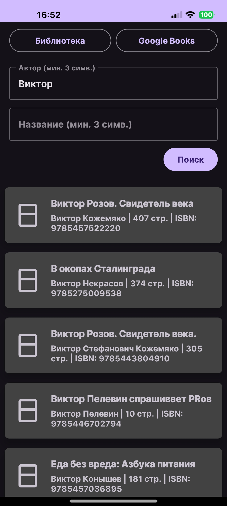
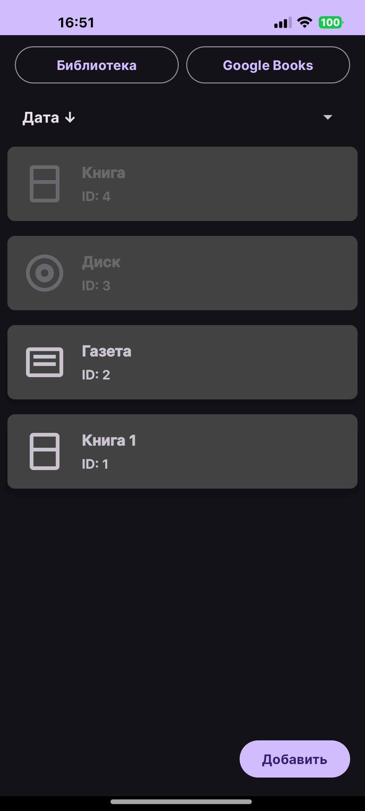
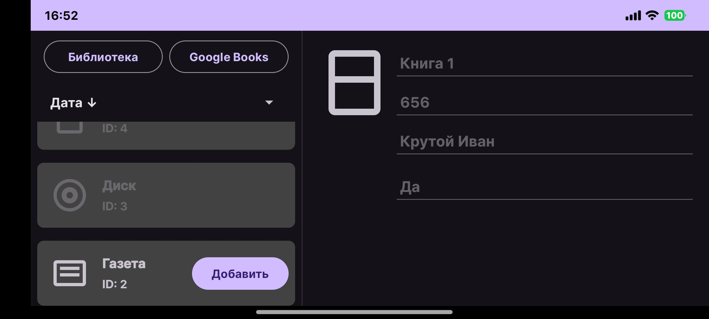

# 📚 Advanced Android App


> **🎓 Контекст:** Финальный проект очного интенсива **Т-Банк (Т-Образование)** на базе МГТУ им. Н.Э. Баумана.
> **Результат:** 2-е место в общем рейтинге курса (99 баллов).

---

## 📱 О приложении

Гибридное Android-приложение, объединяющее поиск книг в интернете и локальное управление медиатекой. Проект демонстрирует навыки работы со сложной архитектурой, сетью, базой данных и адаптивным UI.

**Ключевые фичи:**
*   🌍 **Google Books API:** Асинхронный поиск книг с загрузкой обложек и метаданных.
*   💾 **Локальная БД (Room):** Хранение разнородных типов данных (Книги, Диски, Газеты) с поддержкой **полиморфизма**.
*   📱 **Адаптивность:** Поддержка **Master-Detail Flow** (экран разделяется на список и детали при повороте устройства).
*   🎨 **UI/UX:** Темная тема, Shimmer-эффекты, кастомные диалоги добавления и сортировка списков.

---

## 📸 Галерея интерфейса

### 1. Поиск и Локальное хранение
Реализована работа с сетью (Retrofit) и локальной базой данных (Room).

| Поиск (Google Books) | Локальная медиатека |
|:---:|:---:|
|  |  |

### 2. Адаптивный режим (Tablet Mode)
Приложение автоматически перестраивает верстку в горизонтальной ориентации, отображая список и детали на одном экране (Fragment Communication).

<p align="center">
  
</p>

---

## 🛠 Технический стек

Приложение построено на современном стеке, принятом в разработке.

| Категория | Технологии | Описание |
| :--- | :--- | :--- |
| **Language** | `Kotlin` | Использование Coroutines, Flow, Sealed Interfaces |
| **Architecture** | `Clean Arch`, `MVVM` | Четкое разделение на Data, Domain, Presentation |
| **DI** | `Dagger 2` | Внедрение зависимостей (Modules, Components, Scopes) |
| **Network** | `Retrofit 2`, `OkHttp` | Работа с REST API, перехват ошибок |
| **Local Data** | `Room` | ORM для SQLite, сложные запросы, миграции |
| **Images** | `Glide` | Асинхронная загрузка и кеширование обложек |
| **UI** | `ViewBinding`, `Fragments` | Работа с жизненным циклом, FragmentManager |

---

## 🏛 Архитектура (Clean Architecture)

Соблюден принцип разделения ответственности (SoC). Каждый слой независим и тестируем.

1.  **Presentation:**
    *   `ViewModels` общаются с UI через `StateFlow`.
    *   Реализована навигация и передача данных между фрагментами.
2.  **Domain:**
    *   Содержит бизнес-логику (UseCases).
    *   Не зависит от Android Framework (чистый Kotlin).
3.  **Data:**
    *   `Repository` решает, откуда брать данные (API или Cache).
    *   Реализован маппинг данных (DTO -> Domain Model).

---

## 🚀 Как запустить

1.  Клонируйте репозиторий:
    ```bash
    git clone https://github.com/tunareus/android-t-edu.git
    ```
2.  Откройте проект в **Android Studio**.
3.  Синхронизируйте Gradle и запустите на эмуляторе (рекомендуется API 29+).

---
